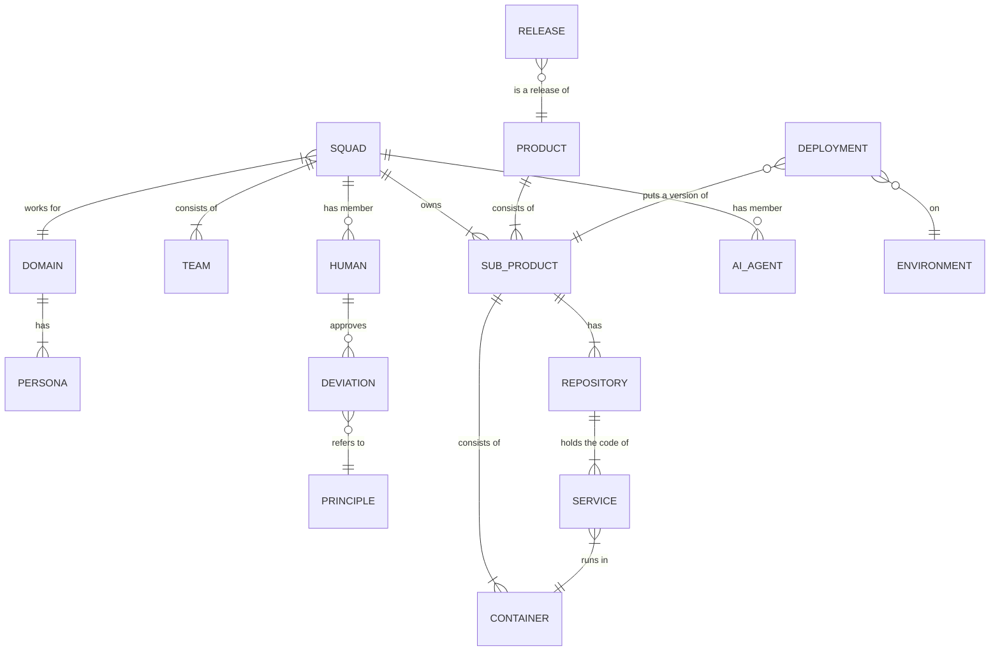

:::note[In progress]
Inventory, far from complete. Grow through doing.
:::

The FCD model is one language: the building blocks of your FCD, described and placed per perspective. Business, IT and teams talk about the same thing.

Borrow words where the market has them, only add what the market lacks. That is why each object lists its market term. The Dutch name is on the talking picture; the code is English.

## The talking picture

*Version 0.8.10, in Dutch. Click the picture for full size. The story with it: [Story and presentation](verhaal-presentatie.md).*

## The objects

Status *confirmed*: description confirmed. Status *concept*: description still to be confirmed. Status *included*: included as an object, description still to be confirmed. Below each object is its name in the code.

| Object | Market term | Description | Status |
|---|---|---|---|
| Persona `Persona` | Person (C4) | The user of the product, who must be at ease. | confirmed |
| Domain `Domain` | Domain (Backstage) | The domain of the persona. | confirmed |
| Organisation `Organization` | Group (Backstage) | The organisation, such as tribe and squad. | confirmed |
| Tribe `Group` (type: tribe) | Group, kind tribe (Backstage) | Part of the organisation. | confirmed |
| Squad `Group` (type: squad, `composition`) | Group, kind squad (Backstage) | Consists of teams working on custom software for one domain. Owns sub-products. Composition: humans, humans and AI agents, or AI agents only. | confirmed |
| Human `Human` | User (Backstage), Person | A human in the organisation, such as a product owner or developer. Can be owner and approve. Member of a squad. | confirmed |
| AI agent `AIAgent` | no fixed term; own object | An AI agent doing work in a squad, such as building, testing or reviewing. Cannot be owner and cannot approve. | confirmed |
| Principle (*kader*) `Principle` | Principle (ArchiMate, TOGAF) | One guiding statement, with what and why. Can belong to several perspectives. Comply or explain. Property: explain allowed (yes or no). | confirmed |
| Deviation `Explanation` | PolicyException (Kyverno) | The explain for a principle. Refers to one principle and to the object that deviates. With reason, approver and end date. The approver is always a human: the owner. | confirmed |
| Team `Group` (type: team) | Group, kind team (Backstage) | Who does the work. Kinds are possible, such as a platform team. | concept |
| Product `Product` | comparable: System (Backstage) | Sub-products together form a product. Own version (semantic versioning). You release the product. | confirmed |
| Sub-product `SubProduct` | comparable: Component (Backstage); deliberately not adopted | The unit of deployment. Consists of one or more containers. A squad owns it. Own version (semantic versioning). Has one or more repositories. | confirmed |
| Pipeline action `PipelineAction` | TaskRun within PipelineRun (CDEvents) | A step that delivers a sub-product. | concept |
| Environment `Environment` | Environment (CDEvents) | Where a sub-product lands. | concept |
| Quality gate `QualityGate` | none; own term | A moment where something may or may not pass. | concept |
| Dashboard `Dashboard` | none; own term | Shows how things are going. | concept |
| Repository `Repository` | Source (SLSA) | Where the code of one or more services of one sub-product lives. Never crosses the boundary of a sub-product. | confirmed |
| Open source software (OSS) `OpenSourceComponent` | Component (CycloneDX) | Open source components in use. Your own code can be open source too. | concept |
| Library `Library` | Component, kind library (CycloneDX) | A library a sub-product uses. Can be open source. | concept |
| Container `Container` | Container; de facto standard | A service runs in it. Own version (semantic versioning). Built from code and libraries. | confirmed |
| Service `Service` | Service (CDEvents) | Runs in a container. | confirmed |
| Kubernetes cluster `KubernetesCluster` | Kubernetes cluster; de facto standard | Where containers run. | concept |
| Test type `TestType` | none; own term | A kind of test, such as unit or contract. | concept |
| Architecture style `ArchitectureStyle` | none; own term | Such as monolith or microservices. | concept |
| Objective `Objective` | Objective (OKR) | The goal with the intention. | concept |
| Key performance indicator (KPI) `KeyPerformanceIndicator` | Key result (OKR), service level indicator (OpenSLO) | A measurement with the product. | concept |
| Interface `API` | API (Backstage) | The contract between sub-products. | included |
| Value stream `ValueStream` | Value stream (SAFe, IT4IT) | The chain in which value flows to the persona. | included |
| Work item type `WorkItemType` | Flow item (Flow Framework) | Such as feature, defect, risk or debt. | included |
| Key result `KeyResult` | Key result (OKR) | The measurable result of an objective. | included |
| Release `Release` | Release (ITIL) | A release of a product: planned or unplanned (urgent). How a release is composed is a model choice. | included |
| Deployment `Deployment` | Deployment (Port, OpenTelemetry) | One deployment puts one version of one sub-product on one environment. | confirmed |
| Service level objective `ServiceLevelObjective` | SLO (OpenSLO) | The agreed quality of a service. | included |
| Vulnerability `Vulnerability` | Vulnerability (CycloneDX) | A known vulnerability in a component. | included |
| Licence `License` | License (CycloneDX) | The licence of open source software or a library. | included |
| Incident `Incident` | Incident (ITIL) | A disruption for the persona. | included |
| Change `Change` | Change (ITIL) | A change in production. | included |
| Role `Role` | Business role (ArchiMate) | Such as product owner or platform engineer. Can belong to a human or an AI agent. | included |
| Target group `TargetGroup` | none; own term | A group of personas. | included |
| Factory (*fabriek*) `Factory` | none; own term | The standard the platform team provides, such as the golden pipeline. | included |
| Branching strategy `BranchingStrategy` | none; own term | Such as trunk-based or GitFlow. | included |
| Event `Event` | Event (CDEvents) | Such as a started pipeline or a new vulnerability. | included |
| Artefact `Artifact` | Artifact (SLSA, CDEvents) | What the pipeline builds, such as a container image. | included |
| Pipeline `Pipeline` | Pipeline, PipelineRun (CDEvents) | A group of pipeline actions in a fixed order, such as the golden pipeline. | included |
| Backlog `Backlog` | Product backlog (Scrum, IT4IT) | Where the intention lands before it becomes work. | included |

## From code to product

Five building blocks: code, OSS libs, container, sub-product, product. Three verbs:

- **Build:** code and OSS libs become one container.
- **Deploy:** per sub-product. One deployment puts one version of one sub-product on one environment.
- **Release:** on the product. The product becomes available to the user.

Container, sub-product and product each have their own version, in semantic versioning. A repository never crosses the boundary of a sub-product.

## Principles

One principle is one statement. Comply or explain applies to every principle. Together the principles are the guardrails for AI.

| Principle | Explain allowed |
|---|---|
| Containerization | yes |
| Kubernetes | yes |
| Automate everything | yes |
| Single source of truth | yes |
| Everything as code | yes |
| Declarative | yes |
| GitOps (declarative, single source of truth, automatic rollout) | yes |
| CI/CD – the only way to production | no |
| Contract first: between sub-products | to be decided |
| Datamodel first: within a sub-product | to be decided |

An unplanned urgent release also goes through the pipeline. That is why there is no explain for "the only way to production".

## Entity relationship model

Confirmed relationships only.

Model choices: one or more personas per domain, and one monorepo per sub-product or one repository per service.

## FCD criteria

Six criteria. They apply to the product and to FCD itself.

| FCD criterion | Dutch | ISO/IEC 25010:2023 |
|---|---|---|
| Reliable | Betrouwbaar | Functional suitability (correctness), compatibility, reliability, flexibility (scalability) |
| Secure and safe | Veilig | Security, safety |
| Complete | Volledig | Functional suitability (completeness) |
| Effective | Effectief | Functional suitability (appropriateness), interaction capability, maintainability (testability) |
| Efficient | Efficiënt | Performance efficiency |
| Budget | Budget | none: no money, no product and no FCD |

Changeability is not an FCD criterion. The product is made again from the intent; what survives that (interfaces, contracts and data) falls under reliable and complete.
