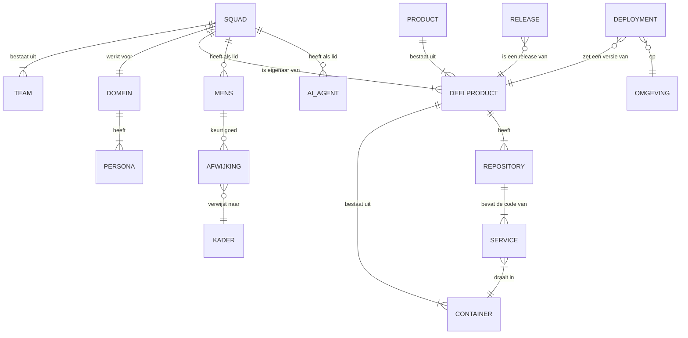

:::note[In ontwikkeling]
Inventaris, verre van compleet. Grow through doing.
:::

Het FCD-model is één taal: de bouwstenen van jouw FCD, beschreven en per perspectief geplaatst. Business, IT en teams praten over hetzelfde.

Woorden lenen waar de markt ze heeft, alleen toevoegen wat de markt mist. Daarom staat bij elk object de marktterm. De Nederlandse naam staat op de [praatplaat](verhaal-presentatie.md); de code is Engels. De volledige lijst objecten staat [onderaan](#de-objecten).

## Van code tot product

Vijf bouwstenen: code, OSS libs, container, deelproduct, product. Drie werkwoorden:

- **Bouwen:** code en OSS libs worden één container.
- **Deployen:** per deelproduct. Eén deployment zet één versie van één deelproduct op één omgeving.
- **Releasen:** per deelproduct. Eén versie van een deelproduct komt beschikbaar voor de gebruiker.

Containers hebben binnen het deelproduct een eigen lifecycle.

Container, deelproduct en product hebben elk een eigen versie, in semantic versioning. Een repository gaat nooit over de grens van een deelproduct heen.

## Kaders

Eén kader is één uitspraak. Bij elk kader geldt comply or explain. Samen zijn de kaders de guardrails voor AI.

| Kader | Explain toegestaan |
|---|---|
| Containerization | ja |
| Kubernetes | ja |
| Automate everything | ja |
| Single source of truth | ja |
| Everything as code | ja |
| Declarative | ja |
| GitOps (declarative, single source of truth, automatisch uitrollen) | ja |
| CI/CD – the only way to production | nee |
| Contract first: tussen deelproducten | nog te bepalen |
| Datamodel first: binnen een deelproduct | nog te bepalen |

Ook een ongeplande spoedrelease gaat door de pipeline. Daarom geen explain bij "the only way to production".

## Entity-relationship-model

Alleen bevestigde relaties.

Modelkeuzes: één of meer persona's per domein, en één monorepo per deelproduct of één repository per service.

## FCD-criteria

Zes criteria. Ze gelden voor het product én voor FCD zelf.

| FCD-criterium | Engels | ISO/IEC 25010:2023 |
|---|---|---|
| Betrouwbaar | Reliable | Functional suitability (juistheid), compatibility, reliability, flexibility (schaalbaarheid) |
| Veilig | Secure and safe | Security, safety |
| Volledig | Complete | Functional suitability (volledigheid) |
| Effectief | Effective | Functional suitability (geschiktheid), interaction capability, maintainability (testbaarheid) |
| Efficiënt | Efficient | Performance efficiency |
| Budget | Budget | geen: zonder geld geen product en geen FCD |

Wijzigbaar is geen FCD-criterium. Het product wordt opnieuw gemaakt uit de intent; wat dat overleeft (interfaces, contracten en data) valt onder betrouwbaar en volledig.

## De objecten

Status *bevestigd*: beschrijving bevestigd. Status *concept*: beschrijving nog te bevestigen. Status *opgenomen*: als object opgenomen, beschrijving nog te bevestigen. Onder elk object staat de naam in de code (Engels).

| Object | Marktterm | Beschrijving | Status |
|---|---|---|---|
| Persona `Persona` | Person (C4) | De gebruiker van het product. Die moet senang zijn. | bevestigd |
| Domein `Domain` | Domain (Backstage) | Het domein van de persona. | bevestigd |
| Organisatie `Organization` | Group (Backstage) | De organisatie, zoals tribe en squad. | bevestigd |
| Tribe `Group` (type: tribe) | Group, soort tribe (Backstage) | Onderdeel van de organisatie. | bevestigd |
| Squad `Group` (type: squad, `composition`) | Group, soort squad (Backstage) | Bestaat uit teams die werken aan maatwerksoftware van één domein. Is eigenaar van deelproducten. Samenstelling: mensen, mensen en AI-agents, of alleen AI-agents. | bevestigd |
| Mens `Human` | User (Backstage), Person | Een mens in de organisatie, zoals een product owner of ontwikkelaar. Kan eigenaar zijn en goedkeuren. Lid van een squad. | bevestigd |
| AI-agent `AIAgent` | geen vaste term; eigen object | Een AI-agent die werk doet in een squad, zoals bouwen, testen of reviewen. Kan geen eigenaar zijn en niet goedkeuren. | bevestigd |
| Kader `Principle` | Principle (ArchiMate, TOGAF) | Eén richtinggevende uitspraak, met wat en waarom. Kan aan meerdere perspectieven hangen. Comply or explain. Eigenschap: explain toegestaan (ja of nee). | bevestigd |
| Afwijking `Explanation` | PolicyException (Kyverno) | De explain bij een kader. Verwijst naar één kader en naar het object dat afwijkt. Met reden, goedkeurder en einddatum. De goedkeurder is altijd een mens: de eigenaar. | bevestigd |
| Team `Group` (type: team) | Group, soort team (Backstage) | Wie het werk doet. Soorten zijn mogelijk, zoals een platformteam. | concept |
| Product `Product` | vergelijkbaar: System (Backstage) | Deelproducten vormen samen een product. Eigen versie (semantic versioning). | bevestigd |
| Deelproduct `SubProduct` | vergelijkbaar: Component (Backstage); bewust niet overgenomen | De eenheid van deployment en van release. Bestaat uit één of meer containers. Een squad is eigenaar. Eigen versie (semantic versioning). Heeft één of meer repositories. | bevestigd |
| Pipeline-actie `PipelineAction` | TaskRun binnen PipelineRun (CDEvents) | Een stap waarmee een deelproduct geleverd wordt. | concept |
| Omgeving `Environment` | Environment (CDEvents) | Waar een deelproduct terechtkomt. | concept |
| Quality gate `QualityGate` | geen; eigen term | Een moment waarop iets wel of niet door mag. | concept |
| Dashboard `Dashboard` | geen; eigen term | Maakt zichtbaar hoe het gaat. | concept |
| Repository `Repository` | Source (SLSA) | Waar de code staat van één of meer services van één deelproduct. Gaat nooit over de grens van een deelproduct heen. | bevestigd |
| Open source software (OSS) `OpenSourceComponent` | Component (CycloneDX) | Open source componenten die worden gebruikt. Ook eigen code kan open source zijn. | concept |
| Library `Library` | Component, soort library (CycloneDX) | Een bibliotheek die een deelproduct gebruikt. Kan open source zijn. | concept |
| Container `Container` | Container; de facto standaard | Hierin draait een service. Eigen versie (semantic versioning). Wordt gebouwd uit code en libraries. | bevestigd |
| Service `Service` | Service (CDEvents) | Draait in een container. | bevestigd |
| Kubernetes-cluster `KubernetesCluster` | Kubernetes cluster; de facto standaard | Waar containers draaien. | concept |
| Testsoort `TestType` | geen; eigen term | Een soort test, zoals unit of contract. | concept |
| Architectuurstijl `ArchitectureStyle` | geen; eigen term | Zoals monoliet of microservices. | concept |
| Objective `Objective` | Objective (OKR) | Het doel bij de intentie. | concept |
| Key performance indicator (KPI) `KeyPerformanceIndicator` | Key result (OKR), service level indicator (OpenSLO) | Een meting bij het product. | concept |
| Interface `API` | API (Backstage) | Het contract tussen deelproducten. | opgenomen |
| Keten `ValueStream` | Value stream (SAFe, IT4IT) | De keten waarin waarde naar de persona stroomt. | opgenomen |
| Soort werk `WorkItemType` | Flow item (Flow Framework) | Zoals feature, defect, risk of debt. | opgenomen |
| Key result `KeyResult` | Key result (OKR) | Het meetbare resultaat bij een objective. | opgenomen |
| Release `Release` | Release (ITIL) | Een release van een deelproduct: gepland of ongepland (spoed). Hoe een release is samengesteld, is een modelkeuze. | opgenomen |
| Deployment `Deployment` | Deployment (Port, OpenTelemetry) | Eén deployment zet één versie van één deelproduct op één omgeving. | bevestigd |
| Service level objective `ServiceLevelObjective` | SLO (OpenSLO) | De afgesproken kwaliteit van een service. | opgenomen |
| Kwetsbaarheid `Vulnerability` | Vulnerability (CycloneDX) | Een bekende kwetsbaarheid in een component. | opgenomen |
| Licentie `License` | License (CycloneDX) | De licentie van open source software of een library. | opgenomen |
| Incident `Incident` | Incident (ITIL) | Een verstoring voor de persona. | opgenomen |
| Change `Change` | Change (ITIL) | Een wijziging in productie. | opgenomen |
| Rol `Role` | Business role (ArchiMate) | Zoals product owner of platform engineer. Kan aan een mens of een AI-agent hangen. | opgenomen |
| Doelgroep `TargetGroup` | geen; eigen term | Een groep persona's. | opgenomen |
| Fabriek `Factory` | geen; eigen term | De standaard die het platformteam levert, zoals de golden pipeline. | opgenomen |
| Branchingstrategie `BranchingStrategy` | geen; eigen term | Zoals trunk-based of GitFlow. | opgenomen |
| Gebeurtenis `Event` | Event (CDEvents) | Zoals een gestarte pipeline of een nieuwe kwetsbaarheid. | opgenomen |
| Artefact `Artifact` | Artifact (SLSA, CDEvents) | Wat de pipeline bouwt, zoals een container-image. | opgenomen |
| Pipeline `Pipeline` | Pipeline, PipelineRun (CDEvents) | Een groep pipeline-acties in een vaste volgorde, zoals de golden pipeline. | opgenomen |
| Backlog `Backlog` | Product backlog (Scrum, IT4IT) | Waar de intentie landt voordat het werk wordt. | opgenomen |

